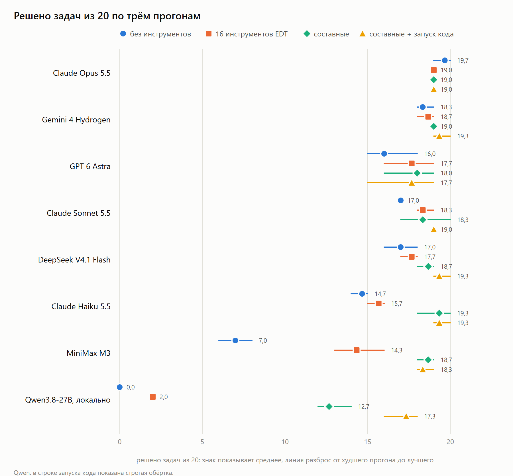
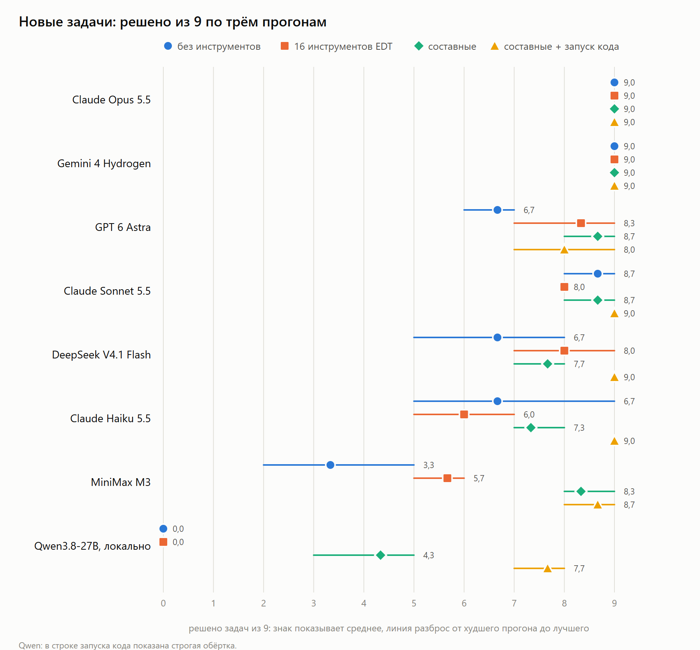
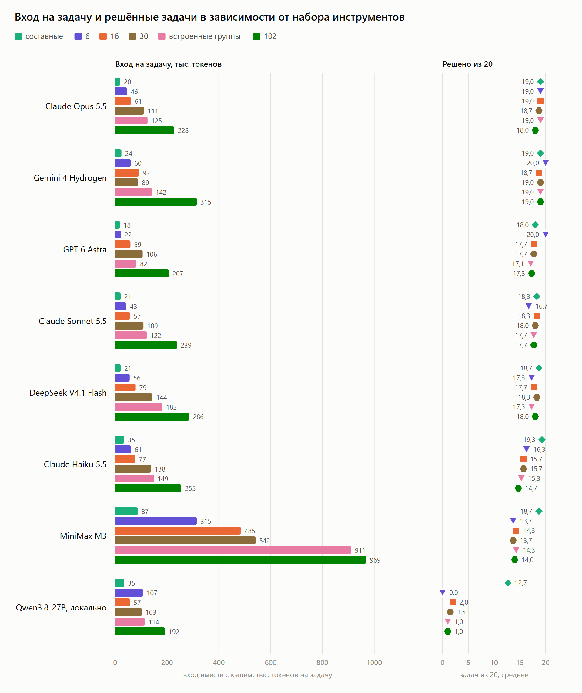
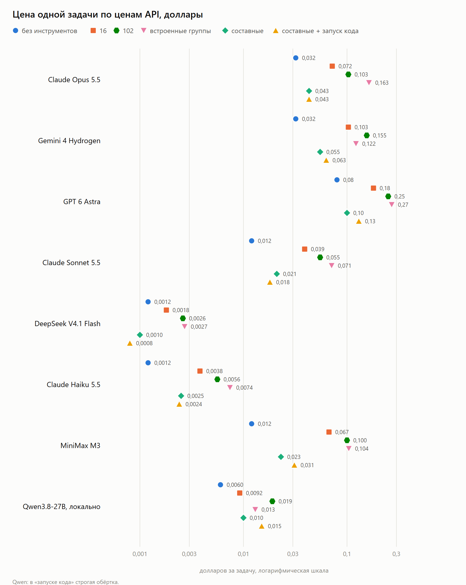
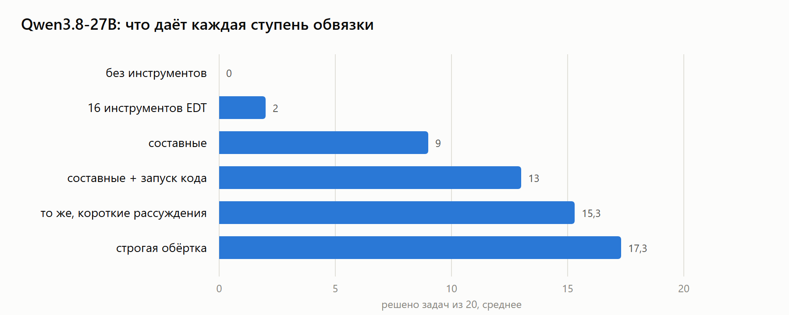

# Результаты

Сводка из статьи [«Модель или обвязка: что решает, когда ИИ-агент пишет код 1С через EDT»](https://infostart.ru/1c/articles/2858222/).
Выводы и разбор - в статье. Данные и цены на 26.11.2026.

## Основные задачи B1-B20

## Новые задачи B21-B29

## Ширина набора инструментов

## Цена задачи

Доллары по ценам API, одни тарифы для всех моделей (раздел `prices` в `settings.example.yaml`).

## Локальная модель

